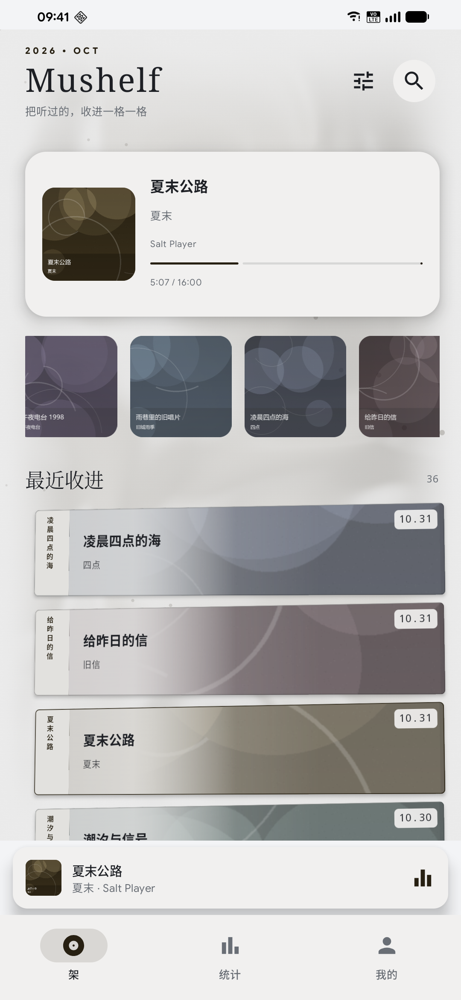
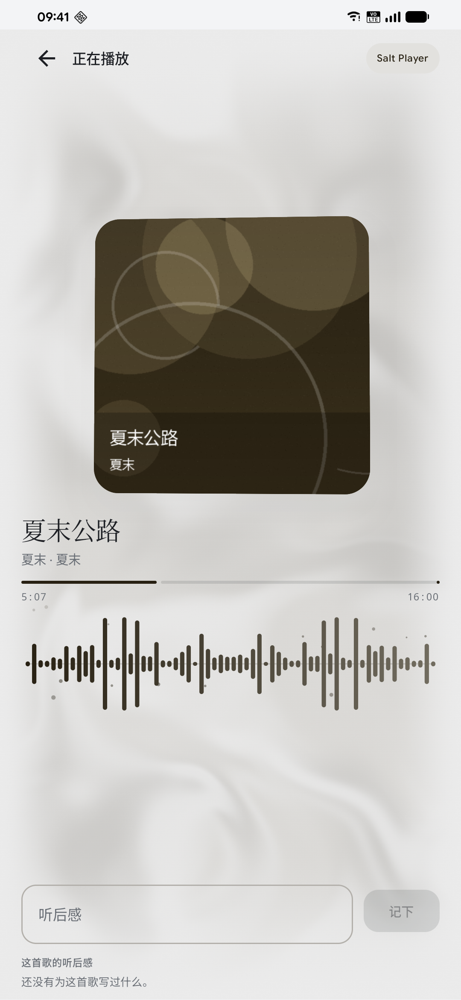
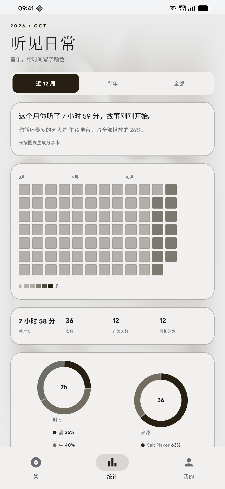
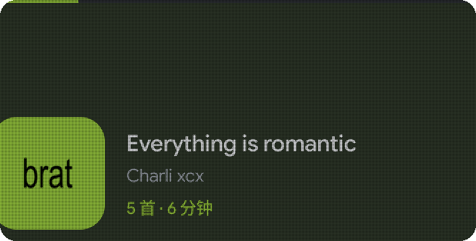
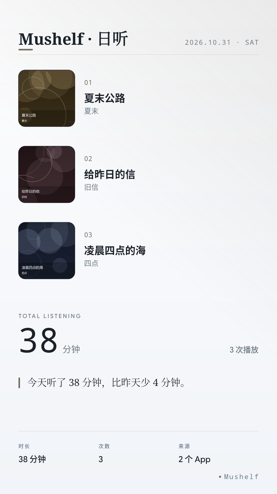
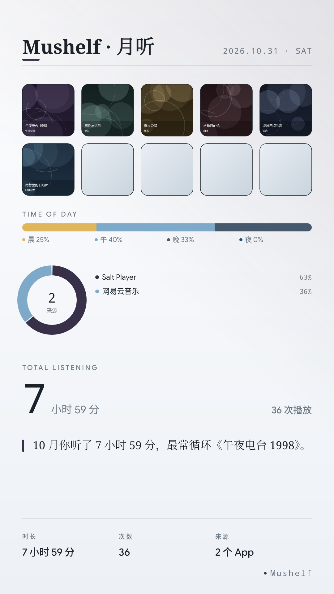
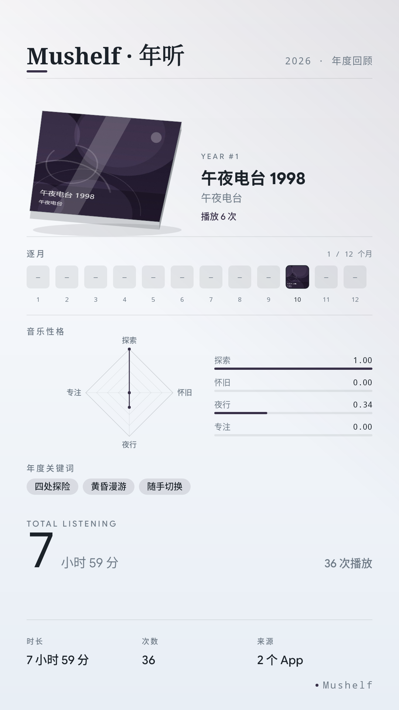

# Mushelf

**把听过的音乐，收进一格一格。**

Mushelf 是一款把「收听记录」做成实体 CD 收藏架的 Android 应用。它不播放音乐，只安静地记录你在各个音乐 App 里听过的每一首，把时间、封面和心情，整理成一排可以翻阅的唱片。

  
  
  
  

## 它是什么

- **一面 CD 架**：每次收听变成一张 2.5D 唱片盒，封面从封面色里渐显，左侧书脊竖排着曲名与日期
- **一份听歌档案**：热力图、时段、艺人、App 占比、连续天数，日卡 / 月卡 / 年卡随时生成
- **一件可以送出去的东西**：1080×1920 的分享卡，或者 5 秒的动态视频卡

## 核心体验

| | |
| --- | --- |
| **实时封面** | 正在播放的歌曲，封面、进度、来源实时同步 |
| **液态流光** | 背景从当前封面取色，晕染成缓慢流动的光 |
| **全量浸染** | 卡片、按钮、图表、声纹，全部随封面换色 |
| **2.5D 手感** | 点一下抽出、长按抬起、拖拽倾斜、松手回弹 |
| **年度回顾** | 年度 CD 盒、12 个月时间轴、四维音乐性格、年度关键词 |
| **桌面组件** | 4×2 小组件，当前曲目与今日收听一眼可见 |

## 报告与分享

  
  
  

- **日卡**：当天最常听的 3 首、总时长、一句属于今天的话
- **月卡**：Top 10、时段分布、App 占比
- **年卡**：年度 CD 盒、12 个月时间轴、音乐性格雷达、3 个关键词
- 可导出为 5 秒 1080×1920 视频，直接分享

## 隐私

- **数据只留在你的设备上**：不联网、不上传、不需要账号
- 即时通讯类应用（Telegram、微信、QQ、钉钉等）的通知在解析前即被丢弃，不读取内容
- 只读取系统媒体会话中的公开播放信息（曲名、艺人、专辑、封面、进度）
- 支持导出 JSON / CSV 备份，随时带走

## 支持

- Android 8.0 及以上
- 已在 Redmi K20 Pro / Android 16 上完整验证
- 通过系统媒体会话兼容 Salt Player、网易云音乐、QQ 音乐、酷狗音乐、Spotify 等播放器
- 本地播放器的播放同样会被记录

## 下载

前往 [ Releases ](https://github.com/amu263/Mushelf-Releases/releases/latest) 下载最新 APK。

> Mushelf 只记录，不播放，也不会遥控其他播放器。

## 关于

Mushelf 为闭源产品，本仓库仅用于发布版本与产品说明，不包含源代码。

遇到问题或有想法，欢迎在 [Issues](https://github.com/amu263/Mushelf-Releases/issues) 留言。

---

Mushelf · 听见日常